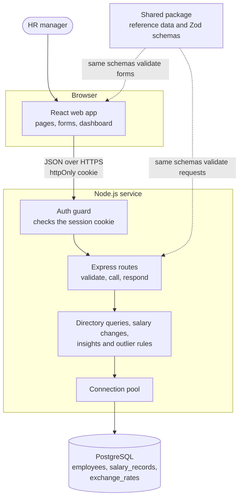
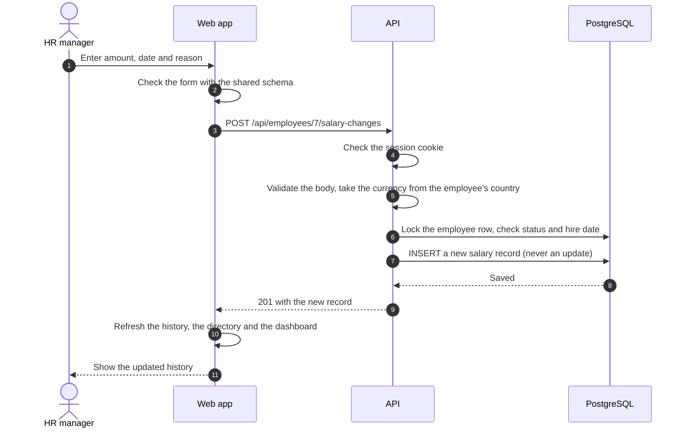
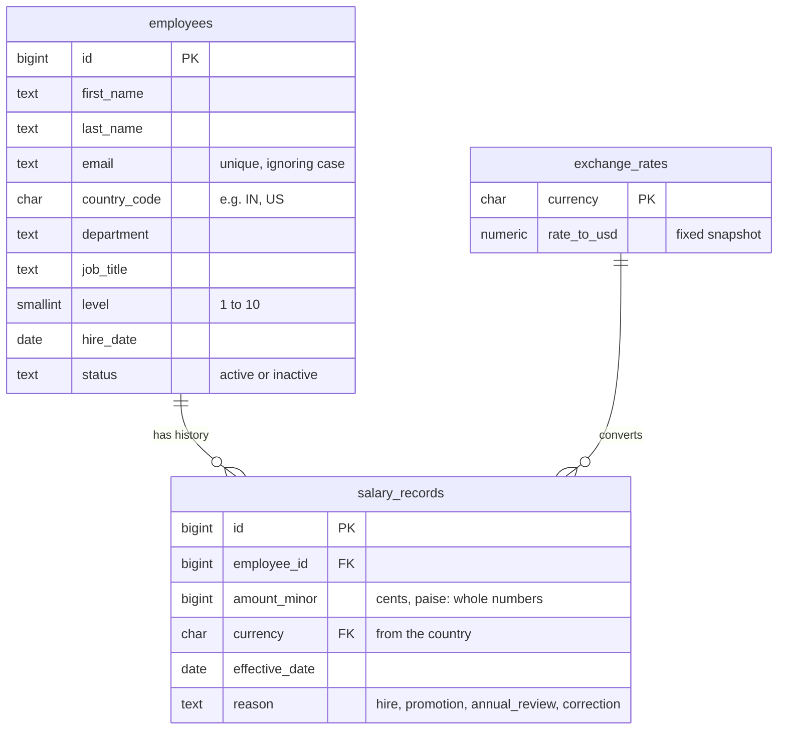

# Architecture

This page shows how the pieces fit together, how data is stored, and why the main choices were made. For the tools themselves, see [tech-stack.md](tech-stack.md). For what was given up in each choice, see [trade-offs.md](trade-offs.md).

## The system

- The browser talks to one place: the API. Every `/api` route except login sits behind the auth guard.
- The web app and the API share one package of reference data (countries, currencies, departments, job titles) and Zod schemas. A rule such as "level is 1 to 10" is written once and checked in the form, in the API, and again by a database constraint.
- In development, the Vite dev server forwards `/api` to the API, so the browser sees one site. In production a single service is meant to serve the built web app and the API, for the same reason: the login cookie is `SameSite=Strict`, which needs one site and so needs no CSRF token.

## What happens when HR changes a salary

The refresh in step 9 is one cache key: anything that reads employees or salaries (the directory, the detail page, every dashboard section) is refetched when a salary changes, so no screen shows stale numbers.

## Data model

How the model supports the requirements:

- **Money is a whole number of minor units** (cents, paise), never a decimal or float, so sums and conversions have no rounding drift. The currency is stored beside every amount.
- **History is append-only.** A database trigger rejects any `UPDATE` or `DELETE` on `salary_records`, so a bug or a manual query cannot rewrite history. A wrong entry is fixed by adding a record with the reason `correction`.
- **Current salary** is the latest record by `(effective_date, id)`. An index on `(employee_id, effective_date DESC, id DESC)` makes that one lookup per employee. Every screen that shows a salary uses the same SQL, so the directory, the detail page and the dashboard cannot disagree.
- **Employees are deactivated, never deleted.** A foreign key stops anyone with salary history from being removed.
- **USD comparison** uses `exchange_rates`, a fixed snapshot rather than live rates, so reports are consistent and explainable. The conversion is one SQL expression with a single rounding step.
- **Checks at every layer.** Column constraints in the database are the last line of defence behind the API's validation.

## How the dashboard gets its numbers

All dashboard figures describe **active employees at their current salary, in US dollars**. One shared query fragment defines that population, so every section agrees.

| Section                           | How it is computed                                                                                                                                                                                            |
| --------------------------------- | ------------------------------------------------------------------------------------------------------------------------------------------------------------------------------------------------------------- |
| Headcount and payroll             | One aggregate query grouped by country and by department.                                                                                                                                                     |
| Minimum, median, average, maximum | One `GROUPING SETS` query with `percentile_cont(0.5)`, grouped by country, department, job title or level.                                                                                                    |
| Salary histogram                  | Two queries: find the range, then count per bucket. The bucket width is rounded to a readable value (1, 2, 2.5, 5, 10 × a power of ten).                                                                      |
| Outliers                          | Each person is compared with peers who share a job title, level and country, using the median and the median absolute deviation, so one extreme salary cannot hide itself. Groups under 5 people are skipped. |

Outliers are a reason to look, not a verdict: they suggest where an HR manager should check, and some people sit in peer groups too small to be judged.

## Request path inside the API

1. **Request logging** records every request (cookies and passwords are redacted).
2. **helmet and CORS** set safe headers; only the web app's origin is allowed.
3. **Login rate limit** applies to the login route only.
4. **Auth guard** verifies the cookie on every other `/api` path. An unknown `/api` path also answers 401, so routes cannot be discovered without logging in.
5. **Route** validates the query or body with a Zod schema, calls the data code, and responds. Routes stay thin.
6. **Data code** runs parameterised SQL (`$1`, `$2`): user input is never put into SQL text. Writes that touch several tables run in one transaction.
7. **Error handler** turns every failure into one JSON shape with a request id. Server errors return a generic message; the detail goes to the log only.

## Testing approach

- **Pure logic** (currency, statistics, histogram widths, outlier rules) is tested without a database.
- **API tests** send real HTTP requests to the app in memory against a separate PostgreSQL test database. Each test creates its own data.
- **Web tests** render screens with React Testing Library and a fake API, and check what a user sees.
- Tests were checked by **breaking the code on purpose** and confirming a test fails.
